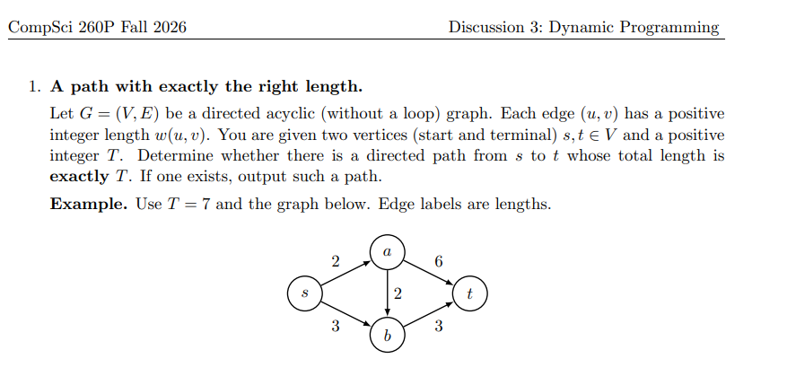

# Exact Path Weight Reachability in DAGs (Dynamic Programming)

A C++ implementation solving the **Exact Path Length Problem** on Directed Acyclic Graphs (DAGs) using both top-down memoized recursion and bottom-up iterative dynamic programming.

## Problem Statement

Given a Directed Acyclic Graph $G = (V, E)$ with positive integer edge weights $w(u, v)$, a starting vertex $s$, a target vertex $t$, and a positive integer $T$, determine whether there exists a directed path from $s$ to $t$ whose total weight is **exactly $T$**.

### Recurrence Relation

Recurse across all parent vertices for a vertex i. If the reach(i, remaining_weight) = 1, return 1. Else, return 0

**Base Cases:**
* $\text{Reach}(s, 0) = 1$
* $\text{Reach}(v, 0) = 0 \quad \forall v \neq s$
* $\text{Reach}(v, t') = 0 \quad \forall t' < 0$

---

## Graph Definitions & ASCII Diagrams

### Test Case 1
Described in question 1 in my Fall 2026 CS260P Lab discussion  


* **Vertices**: $V = \{s, a, b, t\}$
* **Target $T$**: $7$

### Test Case 2

* **Vertices**: $V = \{s, a, b, c, t\}$
* **Target $T$**: $10$

```
(3)         (4)
    /------> [a] ------> [c] \ (2)
   /          |           ^   \
[s]           |(1)     (1)|    \-----> [t]
   \          v           |           /
    \------> [b] ---------/          /
       (1)         (5)              / (6)
   \-------------------------------/
```

## Dynamic Programming Output Tables
### Test Case 1
```
--- DP Table (Rows: Vertices, Columns: Distance 0 to 7) ---

   V \ T   0   1   2   3   4   5   6   7
----------------------------------------
     s |   1   0   0   0   0   0   0   0
     a |   0   0   1   0   0   0   0   0
     b |   0   0   0   1   1   0   0   0
     t |   0   0   0   0   0   0   1   1
```

### Test Case 2
```
--- DP Table (Rows: Vertices, Columns: Distance 0 to 10) ---

   V \ T   0   1   2   3   4   5   6   7   8   9  10
----------------------------------------------------
     s |   1   0   0   0   0   0   0   0   0   0   0
     a |   0   0   0   1   0   0   0   0   0   0   0
     b |   0   1   0   0   1   0   0   0   0   0   0
     c |   0   0   0   0   0   0   1   1   0   1   0
     t |   0   0   0   0   0   0   1   0   1   1   0
```